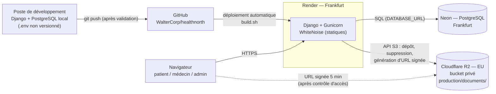
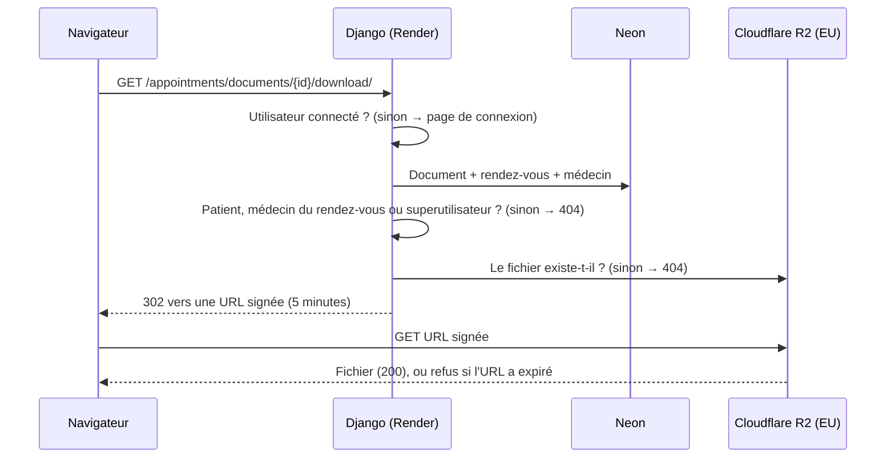

# Journal de maintenance — Health North

**Projet :** Health North, application web Django / PostgreSQL de réservation de rendez-vous médicaux
**Dépôt :** github.com/WalterCorp/healthnorth (public), branche `main`
**Production :** https://healthnorth.onrender.com
**Cadre :** BTS SIO option SLAM — épreuve E6 (session 2027, épreuve ponctuelle)
**Période couverte :** 1er au 3 novembre 2026
**Auteur :** Walter Jean Charles

---

## Sommaire

- [Méthode de travail et outillage](#méthode-de-travail-et-outillage)
- [Tableau récapitulatif](#tableau-récapitulatif)
- [Tests automatisés](#tests-automatisés)
- [Fiche 1 — Panne de production : base Supabase en pause, migration vers Neon](#fiche-1--panne-de-production--base-supabase-en-pause-migration-vers-neon)
- [Fiche 2 — Secrets retirés du code et DEBUG désactivé par défaut](#fiche-2--secrets-retirés-du-code-et-debug-désactivé-par-défaut)
- [Fiche 3 — Mots de passe des comptes de test en clair dans seed.py](#fiche-3--mots-de-passe-des-comptes-de-test-en-clair-dans-seedpy)
- [Fiche 4 — Création des comptes de test en transactions atomiques](#fiche-4--création-des-comptes-de-test-en-transactions-atomiques)
- [Fiche 5 — Documents médicaux : stockage privé sur Cloudflare R2 et accès contrôlé](#fiche-5--documents-médicaux--stockage-privé-sur-cloudflare-r2-et-accès-contrôlé)
- [Fiche 6 — Validation des fichiers côté serveur](#fiche-6--validation-des-fichiers-côté-serveur)
- [Fiche 7 — Noms de fichiers aléatoires et migration 0005](#fiche-7--noms-de-fichiers-aléatoires-et-migration-0005)
- [Fiche 8 — Suppression du fichier stocké avec le document](#fiche-8--suppression-du-fichier-stocké-avec-le-document)
- [Fiche 9 — Documents dans l'interface d'administration](#fiche-9--documents-dans-linterface-dadministration)
- [Fiche 10 — Incident évité : clés R2 dans un fichier « .env. » non ignoré](#fiche-10--incident-évité--clés-r2-dans-un-fichier--env--non-ignoré)
- [Fiche 11 — Corrections diverses](#fiche-11--corrections-diverses)
- [Fiche 12 — Validation des rendez-vous côté serveur](#fiche-12--validation-des-rendez-vous-côté-serveur)
- [Fiche 13 — Listes en cascade restaurées après une erreur de validation](#fiche-13--listes-en-cascade-restaurées-après-une-erreur-de-validation)
- [Architecture actuelle](#architecture-actuelle)
- [Vérifications reproductibles](#vérifications-reproductibles)
- [Limites connues et évolutions possibles](#limites-connues-et-évolutions-possibles)
- [Annexe — Index des commits](#annexe--index-des-commits)

---

## Méthode de travail et outillage

Chaque intervention a suivi la même démarche, que j'ai fixée :

1. **Diagnostic** de l'existant (application en ligne, code, historique Git), en lecture seule.
2. **Plan détaillé** (fichiers concernés, changements, risques), que je valide avant toute modification.
3. **Une modification = un commit**, au format `type: description` en anglais (`feat`, `fix`, `docs`, `chore`, `refactor`).
4. **Vérifications après chaque commit** : `python manage.py check`, `makemigrations --check`, démarrage du serveur local et affichage de la page de connexion, tests automatisés, et `collectstatic` en `DEBUG=False` pour les changements de configuration.
5. **Push sur `main` uniquement après mon accord explicite** : un push redéploie automatiquement la production sur Render (le script `build.sh` exécute `migrate`, `loaddata` et `seed` sur la base de production).
6. **Vérification en production** après chaque déploiement.

Aucune commande n'a été exécutée directement sur la base de production : tous les tests de données ont été réalisés sur ma base locale ou sur des bases temporaires créées puis supprimées.

**Outillage.** Pour l'analyse du code, l'implémentation, l'exécution des vérifications et la rédaction de ce journal, j'ai utilisé un assistant IA (Claude Code), en lui fixant le périmètre de chaque intervention, en validant chaque plan avant exécution et chaque modification avant commit. Les actions sur les services de production (Render, Neon, Cloudflare) et les tests manuels en production ont été réalisés par moi.

**Règle de confidentialité.** Ce journal est versionné dans un dépôt public : il ne contient aucun secret, mot de passe, clé, identifiant de compte ni URL signée, même masqués.

**Note sur les compétences.** Chaque fiche met en avant les compétences du **bloc 2** (B2.1, B2.2, B2.3) du référentiel BTS SIO SLAM, puis les compétences secondaires des blocs 1 et 3. **La correspondance est à valider avec la grille officielle d'évaluation de l'épreuve E6.**

---

## Tableau récapitulatif

| N° | Intervention | Date | Type | Commits |
|---|---|---|---|---|
| 1 | Panne de production : base Supabase en pause → migration vers Neon | 01/11/2026 | Corrective | `09b1d3c` (+ configuration Render) |
| 2 | Secrets retirés du code, DEBUG désactivé par défaut | 01/11/2026 | Sécurité | `abf4006` |
| 3 | Mots de passe des comptes de test en clair dans `seed.py` et la collection Bruno | 02/11/2026 | Sécurité | `5712200`, `8471256` |
| 4 | Comptes de test créés en transactions atomiques | 02/11/2026 | Corrective | `625feff` |
| 5 | Documents médicaux : stockage R2 privé et accès contrôlé | 02/11/2026 | Sécurité / évolutive | `f617e2d`, `1296b79`, `6cc8dad` |
| 6 | Validation des fichiers côté serveur (extension, taille, type, signature binaire) | 02/11/2026 | Sécurité | `34bb057`, `cd0ed93` |
| 7 | Noms de fichiers aléatoires (RGPD), migration 0005 sans SQL | 02/11/2026 | Sécurité | `8c713d2` |
| 8 | Suppression du fichier stocké avec le document | 02/11/2026 | Évolutive | `3698aaf` |
| 9 | Documents dans l'admin (superutilisateur, lien sécurisé) | 02/11/2026 | Évolutive | `4ba5388` |
| 10 | Incident évité : clés R2 dans un fichier « .env. » non ignoré | 02/11/2026 | Sécurité | `eaafba5` |
| 11 | Corrections diverses (STORAGES/WhiteNoise, .gitignore, README, pied de page, fuseau horaire, messages d'erreur de connexion) | 01–02/11/2026 | Corrective | `2b4e279`, `74a5e63`, `47f57ca`, `3a2ac18` (+ `abf4006`, `09b1d3c`, `6cc8dad`) |
| 12 | Validation des rendez-vous côté serveur (formulaires web et API, test Bruno) | 02/11/2026 | Corrective | `47ce05a` |
| 13 | Listes en cascade restaurées après une erreur de validation | 03/11/2026 | Corrective | `9aecb1c` |

## Tests automatisés

**64 tests automatisés**, tous au vert, dans `appointments/tests.py` et `accounts/tests.py` (avant ces interventions, ces deux fichiers étaient vides).

| Classe de tests | Nombre | Fiches |
|---|---|---|
| `DocumentDownloadTests` — contrôle d'accès aux documents | 12 | 5 |
| `DocumentUploadValidationTests` — dépôt, validation, noms aléatoires, signature | 14 | 6, 7 |
| `DocumentFileDeletionTests` — suppression du fichier stocké | 5 | 8 |
| `DocumentAdminTests` — documents dans l'admin | 4 | 9 |
| `LocalTimezoneDisplayTests` — fuseau horaire de l'admin | 3 | 11 |
| `ErrorMessageDisplayTests` — style et icône des messages d'erreur | 1 | 11 |
| `LoginErrorDisplayTests` (`accounts/tests.py`) — erreurs de connexion | 4 | 11 |
| `AppointmentValidationTests` — validation des rendez-vous (web et API), restauration de la cascade | 21 | 12, 13 |

Les tests liés aux documents forcent un stockage sur disque dans un dossier temporaire (supprimé à la fin) : ils ne contactent jamais Cloudflare R2. Commande (en local, avec un rôle PostgreSQL autorisé à créer la base de test) :

```bash
python manage.py test
```

---

## Fiche 1 — Panne de production : base Supabase en pause, migration vers Neon

**Date :** 1er novembre 2026 · **Type :** corrective

> **Résumé oral (30 secondes).** En préparant la session 2027, le diagnostic de l'application en ligne a révélé une erreur 500 dès qu'on essayait de se connecter. La cause était la base de données : j'ai constaté sur le tableau de bord Supabase que le projet gratuit était en pause faute d'activité, et vérifié sur Render que l'application pointait bien vers cette base. J'ai migré la base vers Neon, configuré la nouvelle URL de connexion sur Render, puis redéployé : le script de déploiement a recréé le schéma et les données de démonstration. La connexion fonctionne de nouveau en production.

### Constat

Lors d'un diagnostic complet de mes projets, les pages publiques de Health North s'affichaient (code 200), y compris la page de connexion. En revanche, **une tentative de connexion avec un identifiant inexistant renvoyait une erreur 500** au lieu de réafficher le formulaire avec un message d'erreur. Les pages qui s'affichaient n'interrogent pas la base ; la première requête SQL échouait. En pratique, il était impossible de se connecter ou de prendre un rendez-vous.

### Analyse

- Le serveur d'application (Gunicorn sur Render) répondait : le problème n'était pas l'hébergement.
- Le README indiquait une base PostgreSQL hébergée chez **Supabase**. Le dernier déploiement datait de mars 2026.
- L'offre gratuite de Supabase **met les projets en pause après une semaine d'inactivité**, ce qui expliquait une base injoignable.
- **J'ai confirmé la cause par deux vérifications :**
  - sur le **tableau de bord Supabase**, le projet affichait « **Project is paused** » ;
  - dans les **variables d'environnement de Render**, l'hôte de `DATABASE_URL` était bien un hôte Supabase (pooler de connexions) : la production utilisait cette base en pause.

La cause est donc confirmée par constat direct, et pas seulement déduite de la documentation.

### Solution

J'ai créé une base PostgreSQL chez **Neon**, puis mis à jour la variable `DATABASE_URL` dans le tableau de bord Render. Au déploiement suivant, `build.sh` a exécuté `migrate` (création du schéma), `loaddata` (spécialités, examens, cliniques) et `seed` (comptes de démonstration).

**Anciennes données.** Je n'ai pas repris les données de la base Supabase : il s'agissait uniquement de données de démonstration, et `build.sh` recrée les données de référence et les comptes de test. Je n'ai volontairement pas fait de sauvegarde avant la suppression, puisque le `seed` recrée ces données. Après avoir vérifié que la production fonctionnait sur Neon, j'ai **supprimé définitivement le projet Supabase le 1er novembre 2026 au soir**, pour ne pas laisser en ligne une base inutilisée. La documentation a été mise à jour : README (Neon à la place de Supabase, section « Lancer le projet en local ») et commentaire de `settings.py` (la base est sur Neon, Render n'héberge que l'application).

**Pourquoi Neon.** Conditions des offres gratuites vérifiées en novembre 2026, au moment de la migration, sur la documentation officielle des fournisseurs :

| Fournisseur | Offre gratuite | Conséquence pour mon projet |
|---|---|---|
| Supabase | Projet mis en pause après **1 semaine d'inactivité** | C'est la cause de la panne : un projet d'examen consulté ponctuellement serait régulièrement en pause. |
| Render Postgres | Base gratuite **supprimée 30 jours après sa création** (14 jours de grâce pour passer à une offre payante, puis suppression des données) | Il faudrait recréer et repeupler la base chaque mois. |
| Neon | Le calcul se met en veille après 5 minutes d'inactivité et **redémarre automatiquement** à la requête suivante, en quelques centaines de millisecondes | Pas d'expiration ni de réactivation manuelle. |

Mes autres raisons :
- **Centralisation des outils** : j'utilise déjà Neon sur un autre de mes projets.
- **Aucune expiration ni renouvellement manuel** à prévoir avant l'examen.
- **Région Frankfurt**, la même que mon service Render : latence réduite entre l'application et la base.
- **Organisation Neon dédiée**, séparée de mes autres projets.

### Tests réalisés

- **Avant :** tentative de connexion avec un identifiant fictif → **500**.
- **Après la migration et le redéploiement :** même test → **200** (formulaire réaffiché : la base répond), pages d'accueil, de connexion et d'administration → 200.
- Suppression définitive du projet Supabase le 1er novembre au soir, une fois la production vérifiée sur Neon.
- Par la suite, connexion avec le compte `patient1` et dépôt d'un document en production (fiche 5).

### Commits concernés

| Commit | Message |
|---|---|
| `09b1d3c` | `docs: replace Supabase with Neon and add local setup guide` |

La migration elle-même ne passe pas par le code : `settings.py` lit déjà l'URL de la base dans la variable `DATABASE_URL`, que j'ai modifiée sur Render.

### Compétences mobilisées

- **B2.2** Assurer la maintenance corrective d'une solution applicative : diagnostic d'une panne de production, rétablissement du service.
- **B2.3** Gérer les données : migration de la base, recréation du schéma et des données de référence.
- *Secondaires :* **B1.2** Répondre aux incidents ; **B1.5** Mettre à disposition un service informatique (configuration Render).

### Questions probables du jury

**Comment avez-vous identifié que la base était en cause ?**
En trois temps. D'abord le symptôme : les pages sans requête SQL s'affichaient, mais la première action qui interroge la base (la connexion) renvoyait 500. Le diagnostic a testé volontairement la connexion avec un identifiant inexistant : sans problème de base, Django doit simplement réafficher le formulaire ; l'erreur venait donc de l'accès aux données. Ensuite l'hypothèse : la documentation de Supabase indique que les projets gratuits sont mis en pause après une semaine d'inactivité. Enfin la confirmation, par moi-même : le tableau de bord Supabase affichait « Project is paused », et l'hôte de `DATABASE_URL` sur Render était bien un hôte Supabase. Le symptôme, la cause et le lien entre les deux étaient établis avant la migration.

**Pourquoi Neon plutôt que Supabase ou la base gratuite de Render ?**
Supabase met les projets gratuits en pause après une semaine sans activité : c'est exactement la panne que j'ai subie. La base gratuite de Render est supprimée 30 jours après sa création. Neon met seulement le calcul en veille et redémarre automatiquement à la première requête, sans expiration. S'ajoutent la région Frankfurt identique à Render, et le fait que j'utilise déjà Neon.

**Avez-vous perdu des données ?**
Uniquement des données de démonstration, et c'était un choix. La nouvelle base a été remplie par `build.sh` (`migrate`, `loaddata`, `seed`), qui recrée les données de référence et les comptes de test : une sauvegarde n'apportait rien. J'ai supprimé le projet Supabase seulement après avoir vérifié que la production fonctionnait sur Neon. Dans une application réelle, avec des rendez-vous de vrais patients, j'aurais fait une sauvegarde (`pg_dump`), une restauration sur Neon testée avant la bascule, et conservé l'ancienne base jusqu'à validation.

---

## Fiche 2 — Secrets retirés du code et DEBUG désactivé par défaut

**Date :** 1er novembre 2026 · **Type :** sécurité

> **Résumé oral (30 secondes).** Le fichier `settings.py`, publié sur un dépôt public, contenait une clé secrète Django de secours et le mot de passe de ma base locale. Le mode debug était aussi activé par défaut. La solution retenue lit tous les secrets dans des variables d'environnement, avec une erreur explicite s'ils manquent, et met `DEBUG` à `False` par défaut. En régénérant la clé secrète de production, j'ai constaté que l'ancienne commençait elle aussi par « django-insecure- » : la production utilisait très probablement la clé publiée dans le dépôt. Elle est remplacée ; l'ancienne reste visible dans l'historique Git.

### Constat

Le diagnostic a révélé dans `healthnorth/settings.py`, sur un dépôt **public** :
- une `SECRET_KEY` de secours écrite en clair (préfixe `django-insecure-`), utilisée si la variable d'environnement était absente ;
- l'utilisateur et le mot de passe de mon PostgreSQL local écrits en clair ;
- `DEBUG` activé par défaut (`os.environ.get('DEBUG', 'True')`).

En remplaçant la `SECRET_KEY` de production sur Render, **j'ai constaté que l'ancienne valeur commençait par `django-insecure-`**, le préfixe de la clé de secours du dépôt. La production utilisait donc **très probablement** la clé publiée dans le dépôt public. Je reste prudent : je n'ai pas comparé les deux valeurs, et ce préfixe est celui que Django donne à toute clé générée à la création d'un projet ; une autre clé générée de la même façon aurait le même préfixe.

### Analyse

Une valeur par défaut « pratique en local » finit dans l'historique Git, qui est public et conservé pour toujours. Retirer la valeur du fichier ne suffit pas : elle reste lisible dans les anciens commits. Un `DEBUG` actif par défaut signifie qu'un oubli de variable en production afficherait des pages d'erreur détaillées (code, réglages, requêtes).

### Solution

- `SECRET_KEY` et `DATABASE_URL` sont lues **uniquement** depuis l'environnement. En leur absence, Django lève `ImproperlyConfigured` avec un message clair, au lieu de démarrer avec une valeur faible.
- La base est configurée uniquement via `DATABASE_URL` (`dj_database_url`), sans identifiant dans le code.
- `DEBUG` vaut `False` par défaut, `True` seulement si l'environnement le demande.
- En local, les valeurs viennent d'un fichier `.env` (non versionné) chargé avec `python-dotenv` ; sur Render, sans `.env`, ce chargement n'a aucun effet et ne remplace jamais une variable existante.
- Un fichier `.env.example` versionné, sans aucune vraie valeur, documente les variables.
- Mon `.env` local contient une **nouvelle** clé générée avec `get_random_secret_key()`.
- **J'ai régénéré la `SECRET_KEY` de production sur Render** (nouvelle valeur aléatoire) et vérifié `DEBUG=False`.

**Pourquoi ce choix.** Les variables d'environnement sont la pratique standard (méthode « 12-factor ») : le même code tourne en local et en production, seule la configuration change. Lever une erreur plutôt que d'utiliser une valeur par défaut rend l'oubli visible immédiatement.

### Tests réalisés

- `python manage.py check` et démarrage du serveur local : OK.
- Sans `.env` ni variable `SECRET_KEY` : Django s'arrête avec « La variable d'environnement SECRET_KEY est absente… » ; même comportement pour `DATABASE_URL`.
- Requête sur la base locale via le `.env` : OK.
- Production après déploiement : site en ligne ; tentative de connexion avec un identifiant fictif → formulaire réaffiché (200), donc l'application démarre avec la nouvelle configuration et accède à la base.

### Commits concernés

| Commit | Message |
|---|---|
| `abf4006` | `refactor: load secrets and database config from environment` |

### Compétences mobilisées

- **B2.2** Maintenance évolutive : refonte de la configuration de l'application.
- **B2.1** Concevoir et développer une solution applicative : gestion de la configuration par environnement.
- *Secondaires :* **B3.5** Assurer la cybersécurité d'une solution applicative et de son développement ; **B3.4** Garantir la confidentialité des données.

### Questions probables du jury

**Pourquoi ne jamais mettre de secrets dans un dépôt public ?**
Un dépôt public est lisible par tous, copié par des forks et indexé par des robots qui recherchent automatiquement les clés. L'historique Git garde chaque version : un secret publié une fois doit être considéré comme compromis, même s'il est supprimé ensuite. La seule vraie correction est de le **remplacer** (ce que j'ai fait pour la clé de production) ; supprimer la ligne ne suffit pas.

**Que permettait l'ancienne clé publique ?**
La `SECRET_KEY` sert à Django pour **signer** des données : cookies signés (par exemple les messages affichés à l'utilisateur), données signées avec `django.core.signing`, et elle entre dans le calcul des jetons de réinitialisation de mot de passe et du hachage de session. Toute application qui l'utilise repose sur le fait qu'elle est secrète. Une clé connue permet de fabriquer des données que Django croira authentiques. C'est pourquoi je l'ai régénérée en production au lieu de simplement la retirer du code.

**Pourquoi `DEBUG=False` par défaut ?**
Le choix sûr doit être celui par défaut. Avec `DEBUG=True`, une erreur affiche le code source, les réglages et les requêtes SQL. Il vaut mieux qu'un oubli de configuration en local désactive le debug, plutôt qu'un oubli en production l'active.

---

## Fiche 3 — Mots de passe des comptes de test en clair dans seed.py

**Date :** 2 novembre 2026 · **Type :** sécurité

> **Résumé oral (30 secondes).** La commande `seed`, qui crée les comptes de démonstration à chaque déploiement, contenait les mots de passe en clair, dont celui du superutilisateur, sur un dépôt public : n'importe qui pouvait se connecter à l'administration en production. J'ai retenu la lecture de ces mots de passe dans des variables d'environnement ; sans variable, le compte n'est pas créé et un avertissement s'affiche, sans faire échouer le déploiement. J'ai changé à la main les mots de passe des six comptes en production, et le mot de passe resté dans la collection Bruno est désormais lu dans un fichier local non versionné.

### Constat

L'analyse des risques d'un redéploiement (le script `build.sh` relance `seed` sur la base de production) a montré, dans `appointments/management/commands/seed.py`, que les mots de passe des **6 comptes de test** (`admin`, `patient1`, `dr.martin`, `dr.dubois`, `dr.bernard`, `dr.leroy`) y étaient écrits en clair. Le compte `admin` est superutilisateur, avec un mot de passe faible. Le README affirmait pourtant que les mots de passe étaient « disponibles sur demande ».

La relecture de la collection Bruno a ensuite mis en évidence le même défaut : la requête `POST login.yml`, versionnée depuis le 15 mars 2026, contenait en clair le mot de passe de `patient1` — l'ancien mot de passe de test, identique à celui de `seed.py`, déjà changé en production.

### Analyse

Le dépôt étant public, ces identifiants donnaient un **accès complet à l'administration de production** à toute personne lisant le code, tant que les mots de passe n'avaient pas été changés.

### Solution

- `seed` lit les mots de passe dans `SEED_ADMIN_PASSWORD`, `SEED_PATIENT_PASSWORD` et `SEED_DOCTOR_PASSWORD` (commun aux 4 médecins).
- **Variable absente : le compte n'est pas créé**, un avertissement clair s'affiche, mais la commande ne lève pas d'erreur, pour ne jamais faire échouer le build Render.
- **Un compte existant n'est jamais modifié** et son mot de passe n'est jamais réinitialisé.
- L'association cliniques–médecins n'est faite que si les 4 médecins existent (sinon avertissement).
- Les 6 blocs copiés-collés ont été remplacés par une liste de comptes et une méthode commune.
- `.env.example` et README documentent les variables ; le tableau des comptes de test du README liste désormais les 6 comptes.
- **J'ai changé manuellement, dans l'admin, les mots de passe des 6 comptes en production.** Les variables `SEED_*` ne sont volontairement pas définies sur Render : les comptes existent déjà et ne doivent pas être recréés.
- **Collection Bruno :** j'ai retenu la méthode recommandée par Bruno. La requête « POST login » lit le mot de passe dans `{{process.env.PATIENT_PASSWORD}}`, défini dans un fichier `.env` local à la racine de la collection, ignoré par Git. Un `.env.example` sans valeur est versionné ; il a fallu ajouter l'exception `!.env.example` au `.gitignore` de la collection, dont la règle `.env*` ignorait aussi le modèle. Le README explique comment renseigner la variable (section « Tests API avec Bruno »).

### Tests réalisés

Les tests ont été réalisés sur une **base locale temporaire** (copie de ma base ou base vide), créée puis supprimée :

| Test | Situation | Résultat |
|---|---|---|
| A' | Copie de ma base + fixture, 3 variables | Les 4 comptes existants inchangés (empreintes de mot de passe identiques), 2 médecins manquants créés |
| B | Base vide, aucune variable | 6 avertissements, 0 compte, code de sortie 0 |
| C | Base vide, 3 variables | 6 comptes créés, mots de passe vérifiés avec `check_password` |
| D | Base vide, seulement `SEED_ADMIN_PASSWORD` | Seul `admin` créé, 5 avertissements, code 0 |
| E | Deux relances successives | Aucun doublon, rien de réinitialisé |

En production, après déploiement : site en ligne, et le compte `patient1` se connecte avec le mot de passe que j'ai changé à la main (test de la fiche 5) : le déploiement n'a pas réinitialisé les comptes existants.

Collection Bruno : `git check-ignore` confirme que le `.env` de la collection est ignoré et que `.env.example` reste versionnable ; aucun mot de passe de test ne figure dans les 15 fichiers versionnés de la collection ; sur ma base locale, la connexion de `patient1` avec la valeur de `PATIENT_PASSWORD` fonctionne (302, session ouverte, puis API en 200). Exécution dans Bruno, réalisée par moi en local (Bruno 3.1.4, environnement `Local`) : « GET login page (CSRF) » → 200 ; report manuel du jeton CSRF dans `csrfToken` et `csrfCookie` ; « POST login » → 200, page d'accueil connectée « Bienvenue Jean ! ». La variable `{{process.env.PATIENT_PASSWORD}}` est bien lue depuis le `.env` de la collection.

### Commits concernés

| Commit | Message |
|---|---|
| `5712200` | `fix: read seed passwords from environment variables` |
| `8471256` | `fix: read Bruno login password from a local env file` |

### Compétences mobilisées

- **B2.2** Maintenance corrective : correction d'une faille dans un script de déploiement.
- **B2.3** Gérer les données : jeu de données de démonstration idempotent.
- *Secondaires :* **B3.5** Cybersécurité de la solution applicative ; **B3.2** Préserver l'identité numérique (comptes à privilèges).

### Questions probables du jury

**Le problème est-il réglé alors que les anciens mots de passe sont dans l'historique Git ?**
Oui pour la production, parce que j'ai changé les 6 mots de passe : les anciens ne donnent plus accès à rien. C'est le même principe que pour la clé secrète : un secret publié se remplace, il ne se cache pas.

**Pourquoi ne pas lever d'erreur quand une variable manque ?**
`seed` est exécuté à chaque déploiement. Une erreur ferait échouer le build alors que les comptes existent déjà en production : le site ne serait plus mis à jour pour une raison secondaire. Un avertissement suffit et reste visible dans les logs.

**Pourquoi un compte existant n'est-il jamais modifié ?**
Sinon chaque déploiement réinitialiserait les mots de passe changés à la main en production, ce qui annulerait justement la correction de sécurité.

---

## Fiche 4 — Création des comptes de test en transactions atomiques

**Date :** 2 novembre 2026 · **Type :** corrective

> **Résumé oral (30 secondes).** Lors d'un test de `seed` sur une copie de ma base, un médecin a été créé sans son profil de spécialiste, parce que sa spécialité manquait : la commande s'est arrêtée au milieu et a laissé un compte à moitié créé. J'ai retenu une transaction atomique pour la création de chaque compte : soit le compte et son profil sont créés ensemble, soit rien n'est enregistré. Les tests confirment qu'aucun compte incomplet ne peut plus apparaître.

### Constat

Lors du test A de la fiche 3 (copie de ma base locale, sans recharger la fixture), `seed` a créé l'utilisateur `dr.bernard` puis a échoué sur `Specialty.objects.get(pk=3)` : ma base locale ne contenait que 2 spécialités sur 5. Résultat : un **utilisateur médecin sans profil de spécialiste**, donc incohérent. L'ancien code avait exactement le même défaut.

### Analyse

La création d'un médecin comporte deux écritures (l'utilisateur, puis le profil `Specialist`). Sans transaction, si la seconde échoue, la première reste en base.

### Solution

- La méthode `create_account()` est décorée par `@transaction.atomic` : l'utilisateur et son profil sont créés dans la même transaction, annulée entièrement en cas d'erreur.
- Les messages « … créé » ne s'affichent qu'une fois la création complète réussie.
- Une spécialité manquante reste une **erreur** (code de sortie 1) : elle signale une fixture absente, donc une vraie erreur de configuration. Sur Render, `loaddata` est toujours exécuté juste avant `seed`.
- À ma demande, ma base locale a ensuite été alignée sur la production (`loaddata` puis `seed`, après vérification que l'hôte est `localhost`) : 5 spécialités, 14 examens, 6 cliniques, 6 comptes, rendez-vous existants intacts.

### Tests réalisés

| Test | Situation | Résultat |
|---|---|---|
| B, C, E | Base vide, sans / avec variables, relances | Identiques à la fiche 3 |
| F1 | Copie de ma base (fixture incomplète) | Code 1, **`dr.bernard` n'est plus créé** (4 comptes avant, 4 après) |
| F2 | Base vide, spécialités 3 et 4 supprimées | 4 comptes créés, arrêt sur `dr.bernard`, **aucun médecin sans profil** |

### Commits concernés

| Commit | Message |
|---|---|
| `625feff` | `refactor: wrap seed account creation in atomic transactions` |

### Compétences mobilisées

- **B2.3** Gérer les données : cohérence et intégrité des données.
- **B2.2** Maintenance corrective : correction d'un défaut découvert en test.
- *Secondaire :* **B1.4** Travailler en mode projet (tests avant déploiement).

### Questions probables du jury

**Pourquoi une transaction atomique dans `seed` ?**
Une transaction garantit le « tout ou rien » (propriété d'atomicité, le A de ACID). Créer un médecin, c'est deux insertions liées : sans transaction, une erreur sur la seconde laisse un utilisateur sans profil, que l'application ne sait pas gérer. Avec `transaction.atomic`, PostgreSQL annule les deux insertions ensemble.

**Pourquoi une transaction par compte plutôt qu'une seule pour toute la commande ?**
Les comptes sont indépendants : si le dernier échoue, il n'y a pas de raison d'annuler les cinq premiers, qui sont corrects. La transaction couvre l'unité logique, un compte et son profil.

**Comment avez-vous prouvé que la correction fonctionne ?**
J'ai demandé que le cas d'échec soit reproduit volontairement (tests F1 et F2) : les tests montrent qu'avant la correction, `dr.bernard` restait à moitié créé, et qu'après, il n'existe pas du tout.

---

## Fiche 5 — Documents médicaux : stockage privé sur Cloudflare R2 et accès contrôlé

**Date :** 2 novembre 2026 · **Type :** sécurité / évolutive

> **Résumé oral (30 secondes).** Les documents médicaux déposés par les patients n'avaient jamais été consultables en production, et en local ils étaient accessibles sans même être connecté. Ils étaient servis par une route `/media/` publique et stockés sur le disque de Render, effacé à chaque déploiement. J'ai retenu un stockage dans un bucket privé Cloudflare R2 situé dans l'Union européenne, et une vue qui vérifie les droits avant de délivrer une URL signée valable 5 minutes. Les tests automatisés et mes tests manuels en production confirment que seuls le patient, le médecin du rendez-vous et un superutilisateur peuvent ouvrir un document.

### Constat

L'analyse du code, avant la migration du stockage, a mis en évidence deux problèmes :

- **En production, les documents n'avaient jamais été consultables.** Le lien affiché aux patients pointait vers `/media/documents/<nom du fichier>`, route déclarée avec `static(settings.MEDIA_URL, …)` dans `healthnorth/urls.py`. Cette fonction de Django ne fait rien lorsque `DEBUG=False` : en production, le lien menait à une erreur 404. Les fichiers étaient en outre enregistrés sur le disque du serveur Render, qui est effacé à chaque redéploiement.
- **En local, les documents étaient publics.** Avec `DEBUG=True`, `/media/` servait n'importe quel fichier à n'importe qui, **sans même être connecté**, à partir de son URL, qui contenait le nom de fichier d'origine.

Le contrôle d'accès existant ne protégeait que la page de dépôt (`patient=request.user`), pas le fichier lui-même. Le médecin du rendez-vous n'avait aucun moyen de le consulter.

### Analyse

Ces documents (ordonnances, certificats, résultats d'analyse) sont des **données de santé**, une catégorie particulière au sens du RGPD (article 9). Trois exigences en découlent :

1. un stockage **persistant**, indépendant du serveur d'application ;
2. **aucun accès public** au fichier, même avec une URL connue ;
3. une **autorisation vérifiée par l'application** à chaque consultation.

### Solution

| Élément | Choix retenu |
|---|---|
| Stockage | **Cloudflare R2** (compatible S3) via `django-storages[s3]` et `boto3`, configuré avec le réglage `STORAGES` de Django |
| Bucket | **Privé** (aucune ACL publique, aucun domaine public), **juridiction EU** (endpoint `*.eu.r2.cloudflarestorage.com`), clé API limitée à ce seul bucket en lecture/écriture |
| Accès au fichier | **URL signée** (signature AWS v4) valable **5 minutes**, générée à chaque demande |
| Écrasement | Désactivé : un nom déjà pris reçoit un suffixe |
| Environnements | Préfixe `R2_LOCATION` : `local/` en développement, `production/` sur Render |
| Configuration | 4 variables R2 renseignées → R2 ; aucune → disque local ; partielle → erreur `ImproperlyConfigured`, pour ne jamais retomber silencieusement sur le disque éphémère |
| Contrôle d'accès | Vue `document_download` (`appointments/documents/<id>/download/`) : `@login_required`, `@never_cache`, accès réservé au **patient du rendez-vous**, au **médecin du rendez-vous** et aux **superutilisateurs** ; sinon **404** ; puis redirection vers l'URL signée |
| Fichier disparu | 404 (au lieu d'une erreur XML de R2) |
| Route `/media/` | **Supprimée** : plus aucun accès direct, même en local |
| Stockage local sans R2 | La vue sert le fichier elle-même ; seuls PDF, JPEG et PNG s'affichent dans le navigateur, tout autre type est téléchargé |

**Pourquoi ce choix plutôt qu'un autre :**
- *Garder le disque de Render ?* Impossible : il est effacé à chaque déploiement.
- *Stocker les fichiers dans PostgreSQL ?* Cela alourdirait la base et ses sauvegardes, avec un quota limité sur l'offre gratuite de Neon.
- *R2 plutôt qu'AWS S3 ?* R2 est compatible S3 : le code reste standard et portable vers S3 sans modification. Il propose une juridiction EU, et le trafic sortant n'est pas facturé.

### Tests réalisés

**Tests automatisés** (12, classe `DocumentDownloadTests`, stockage sur disque temporaire, sans contacter R2) :
- visiteur non connecté → redirection vers la page de connexion ;
- patient du rendez-vous, médecin du rendez-vous, superutilisateur → accès autorisé ;
- autre patient, autre médecin, utilisateur `is_staff` non superutilisateur, document inexistant, fichier disparu → **404** ;
- fichier HTML → téléchargé, jamais affiché ;
- `/media/…` → 404 ;
- la page de dépôt pointe vers la vue sécurisée et ne contient plus `/media/`.

**Vérification du fonctionnement réel sur R2 depuis mon poste** (préfixe `local/`, sur ma base locale) :

| Vérification | Résultat |
|---|---|
| Dépôt d'un PDF via le formulaire | 302, objet présent dans le bucket |
| Ouverture par le patient | 302 vers l'endpoint EU, `X-Amz-Expires=300`, `Cache-Control: no-store` |
| Téléchargement par l'URL signée | 200, contenu identique au fichier envoyé |
| Ouverture par un autre patient | 404, aucune redirection vers R2 |
| Accès au bucket sans signature / signature altérée | Refusé par R2 (400) |
| URL signée de 3 secondes | 200 immédiatement, **403 après 6 secondes** |
| Nettoyage | Objets de test supprimés, 0 objet sous `local/` |

**Tests manuels en production** (après déploiement) :
- visiteur non connecté sur la vue sécurisée → 302 vers la connexion ; `/media/…` → 404 ;
- dépôt d'un vrai PDF en tant que `patient1` : message « Document déposé avec succès », lien « Ouvrir le document (PDF) » ;
- objet visible dans Cloudflare sous `production/documents/`, avec un nom uuid et le type `application/pdf` ;
- document ouvert et lisible depuis l'espace patient et depuis l'administration.

### Commits concernés

| Commit | Message |
|---|---|
| `2b4e279` | `fix: replace removed STATICFILES_STORAGE with STORAGES setting` (prérequis, fiche 11) |
| `f617e2d` | `feat: store uploaded documents on Cloudflare R2` |
| `1296b79` | `feat: serve medical documents through access-controlled view` |
| `6cc8dad` | `docs: document R2 storage and document access control` |

### Compétences mobilisées

- **B2.2** Maintenance corrective et évolutive : analyse d'un dysfonctionnement en production, évolution du stockage.
- **B2.1** Concevoir et développer une solution applicative : vue Django, configuration du stockage, tests automatisés.
- **B2.3** Gérer les données : stockage objet externe, séparation des données entre environnements.
- *Secondaires :* **B3.1** Protéger les données à caractère personnel ; **B3.5** Cybersécurité de la solution applicative ; **B1.5** Mise à disposition du service (configuration Render).

### Questions probables du jury

**Pourquoi une 404 plutôt qu'une 403 pour un document interdit ?**
Une 403 confirmerait que le document n°X existe. En faisant varier l'identifiant dans l'URL, un attaquant pourrait recenser les documents et en déduire l'activité de la plateforme. Avec une 404, un document interdit et un document inexistant donnent exactement la même réponse : l'application ne révèle rien. C'est la pratique recommandée contre les failles de type IDOR (accès direct à un objet par son identifiant).

**Pourquoi `is_superuser` plutôt que `is_staff` (moindre privilège) ?**
`is_staff` donne seulement accès à l'interface d'administration ; on peut l'accorder à quelqu'un qui gère les cliniques ou les spécialités sans qu'il ait besoin de lire des données de santé. Le principe du moindre privilège consiste à n'accorder que les droits nécessaires : seul le superutilisateur, qui a déjà tous les droits, peut consulter l'ensemble des documents. Un test vérifie qu'un compte `is_staff` reçoit 404.

**Pourquoi un bucket dans l'Union européenne ?**
Il s'agit de données de santé de patients français. Les héberger dans l'UE évite un transfert hors UE, strictement encadré par le RGPD (chapitre V), ce qui simplifie la conformité. La juridiction se choisit à la création du bucket et ne peut pas être modifiée ensuite.
*À noter : en France, l'hébergement de données de santé pour le compte d'un tiers relève de la certification HDS. Health North est un projet pédagogique, mais un déploiement réel l'exigerait.*

**Pourquoi des URLs signées de courte durée plutôt qu'un bucket public ?**
Dans un bucket public, toute personne qui obtient l'URL lit le fichier, sans limite de durée et sans contrôle (historique de navigation, lien transféré, en-tête `Referer`…). Avec un bucket privé, R2 refuse tout accès non signé (vérifié). L'URL signée n'est délivrée **qu'après** le contrôle d'accès de l'application et ne vaut que **5 minutes** (vérifié : refusée après expiration). Une fuite de lien a donc un impact limité dans le temps, et chaque consultation passe par une décision de l'application.

**Que se passe-t-il si l'URL signée est copiée et partagée ?**
Elle reste utilisable au plus 5 minutes : c'est le compromis accepté entre sécurité et confort d'utilisation. Pour aller plus loin, on pourrait réduire la durée, ou faire transiter le fichier par Django, au prix d'une charge plus élevée sur le serveur.

---

## Fiche 6 — Validation des fichiers côté serveur

**Date :** 2 novembre 2026 · **Type :** sécurité

> **Résumé oral (30 secondes).** Le formulaire de dépôt ne filtrait les fichiers que dans le navigateur, avec l'attribut `accept`, facile à contourner : le serveur acceptait n'importe quel fichier, de n'importe quelle taille. J'ai retenu une validation côté serveur : extensions PDF, JPG, JPEG et PNG, 5 Mo maximum, type de document contrôlé, puis, en complément, la vérification des premiers octets du fichier, pour refuser un exécutable ou un texte renommé en `.pdf`. Les tests automatisés et un essai en production confirment le refus des faux fichiers, avec un message clair en français.

### Constat

L'analyse du code menée pour la fiche 5 a montré que :
- les types de fichiers n'étaient filtrés que par l'attribut HTML `accept=".pdf,.jpg,.jpeg,.png"`, contournable en quelques secondes (outils de développement du navigateur, requête directe) ;
- **aucune taille maximale** n'était appliquée ;
- le champ `document_type` était enregistré tel que reçu, sans contrôle par rapport aux valeurs autorisées.

### Analyse

Toute donnée envoyée par le client peut être modifiée : la validation doit avoir lieu sur le serveur. L'extension seule ne garantit pas non plus le contenu, puisqu'un fichier se renomme librement.

### Solution

**Étape 1 — validation par formulaire** (`appointments/forms.py`, `DocumentUploadForm`) :
- extensions autorisées : `pdf`, `jpg`, `jpeg`, `png` (vérifiées sans tenir compte de la casse) ;
- taille maximale : **5 Mo** ;
- `document_type` limité aux choix du modèle ;
- messages d'erreur en français, affichés sous chaque champ ; le type choisi est conservé quand le formulaire est réaffiché.

**Étape 2 — vérification de la signature binaire** : les premiers octets du fichier sont comparés à la signature attendue pour son extension, sans nouvelle dépendance :

| Extension | Signature attendue |
|---|---|
| `.pdf` | `%PDF-` |
| `.png` | `89 50 4E 47 0D 0A 1A 0A` |
| `.jpg`, `.jpeg` | `FF D8 FF` |

En cas de différence : « Le contenu du fichier ne correspond pas à son extension : ce n'est pas un vrai fichier PDF. Vérifiez le document et déposez l'original. »

### Tests réalisés

**Tests automatisés** (classe `DocumentUploadValidationTests`) :
- PDF valide accepté ; extension en majuscules (`.JPG`) acceptée ;
- `.exe`, `.html`, `document.pdf.exe`, fichier sans extension → refusés ;
- fichier de plus de 5 Mo → refusé ; fichier d'exactement 5 Mo → accepté ;
- type de document invalide → refusé ; formulaire sans fichier → refusé ; fichier vide → refusé ;
- un autre patient ne peut pas déposer sur ce rendez-vous (404) ;
- vrais PDF, PNG et JPEG (`.jpg` et `.jpeg`, images générées avec Pillow) → acceptés ;
- texte, exécutable Windows (`MZ…`) et script shell renommés en `.pdf`, PNG renommé en `.jpg`, PDF renommé en `.png` → **refusés avec le message clair**.

**Vérification réelle sur R2 en local :** la vérification montre qu'un exécutable renommé en `.pdf` est refusé, sans document créé et **sans aucun objet envoyé sur R2**, et qu'un vrai PDF est accepté.

**Test manuel en production :** un fichier texte renommé en `.pdf` est refusé avec le message « Le contenu du fichier ne correspond pas à son extension… ».

### Commits concernés

| Commit | Message |
|---|---|
| `34bb057` | `feat: validate uploaded documents server-side` |
| `cd0ed93` | `feat: verify uploaded file content matches its extension` |

### Compétences mobilisées

- **B2.1** Concevoir et développer une solution applicative : formulaire Django, validateurs, messages d'erreur.
- **B2.2** Maintenance évolutive : renforcement d'une fonctionnalité existante.
- *Secondaire :* **B3.5** Cybersécurité de la solution applicative (validation des entrées).

### Questions probables du jury

**Que se passe-t-il si on renomme un `.exe` en `.pdf` ?**
L'extension `.pdf` passe la première vérification, mais les premiers octets d'un exécutable Windows sont `MZ`, et non `%PDF-` : le fichier est refusé avec un message clair, et rien n'est envoyé dans le stockage. C'est vérifié par un test automatisé, par un test réel sur R2 et, pour un fichier texte renommé, en production.

**Quelles sont les limites de cette vérification ?**
Elle contrôle l'**en-tête** du fichier, pas sa structure complète : un fichier qui commence par `%PDF-` mais contient ensuite du contenu corrompu ou malveillant (JavaScript embarqué dans un PDF, par exemple) serait accepté. Elle ne remplace pas un antivirus. Les évolutions possibles sont décrites dans la section « Limites connues ».

**Pourquoi garder aussi l'attribut `accept` dans le navigateur ?**
Pour le confort de l'utilisateur : le sélecteur de fichiers ne propose que les bons formats. Mais il ne sert jamais de sécurité : c'est le serveur qui décide.

**Pourquoi 5 Mo ?**
Une ordonnance ou un certificat scanné tient largement dans cette limite. Elle protège l'application contre l'envoi de fichiers énormes, qui consommeraient le stockage et la bande passante.

---

## Fiche 7 — Noms de fichiers aléatoires et migration 0005

**Date :** 2 novembre 2026 · **Type :** sécurité

> **Résumé oral (30 secondes).** Les fichiers déposés gardaient leur nom d'origine, qui peut contenir le nom du patient ou sa pathologie. J'ai retenu un nom aléatoire (uuid) qui conserve seulement l'extension, et la page affiche « Ouvrir le document (PDF) » au lieu du nom. Ce changement a nécessité une migration Django, alors que la base ne change pas : la vérification avec `sqlmigrate` montre qu'elle n'exécute aucune requête SQL. En production, les fichiers apparaissent bien dans le bucket sous un nom uuid.

### Constat

Avec `upload_to='documents/'`, un fichier « Ordonnance_Jean_Dupont_diabete.pdf » était stocké tel quel : le nom d'un patient et sa pathologie apparaissaient dans le chemin du fichier, dans le stockage et sur la page de dépôt.

### Analyse

Le nom d'un fichier est une donnée à part entière. Le conserver n'apporte rien au fonctionnement, et le principe de **minimisation des données** du RGPD (article 5) demande de ne garder que ce qui est nécessaire.

### Solution

- Une fonction `document_upload_path(instance, filename)` dans `appointments/models.py` génère `documents/<uuid>.<extension>`, avec l'extension en minuscules (`.PDF` devient `.pdf`).
- La page de dépôt affiche « Ouvrir le document (PDF) » (propriété `Document.file_extension`) au lieu du nom.
- **Migration `0005_alter_document_file`** : une opération `AlterField` sur le champ `file`.
- Les documents existants gardent leur chemin ; seuls les nouveaux dépôts reçoivent un nom aléatoire.

### Tests réalisés

- `python manage.py sqlmigrate appointments 0005` → `-- (no-op)` : **aucune requête SQL**.
- Migration appliquée sur la base de test et sur ma base locale (hôte vérifié) ; le document local existant garde son nom et reste accessible.
- Tests automatisés : nom généré au format `documents/<32 caractères hexadécimaux>.pdf` et sans le nom du patient ; deux dépôts du même nom donnent deux fichiers distincts ; la page affiche « Ouvrir le document (PDF) » et jamais le nom stocké.
- Production : objet visible dans Cloudflare sous `production/documents/` avec un nom uuid.

### Commits concernés

| Commit | Message |
|---|---|
| `8c713d2` | `feat: store documents under random file names` |

### Compétences mobilisées

- **B2.3** Gérer les données : migration de schéma, données existantes.
- **B2.2** Maintenance évolutive.
- *Secondaire :* **B3.1** Protéger les données à caractère personnel (minimisation).

### Questions probables du jury

**Pourquoi une migration alors que la base ne change pas ?**
Les migrations Django enregistrent l'état complet de chaque champ du modèle, y compris des options qui ne concernent que Python, comme `upload_to`. Passer de la chaîne `'documents/'` à la fonction `document_upload_path` modifie cet état : sans migration, `makemigrations --check` signale un écart et l'historique des migrations ne reflète plus le modèle. La colonne reste un `varchar(100)` qui contient un chemin : `sqlmigrate` confirme que la migration n'exécute aucune requête (`no-op`). Son déploiement sur Neon est donc instantané et sans risque.

**Pourquoi des noms de fichiers aléatoires (RGPD) ?**
Le nom d'origine peut contenir des données personnelles, voire de santé (nom du patient, pathologie). Il n'est pas nécessaire au service : le type de document et la date suffisent. Un uuid version 4 contient 122 bits aléatoires : il est en pratique impossible à deviner, ce qui ajoute une protection au contrôle d'accès.

**Y a-t-il une contrainte pour la suite ?**
Oui : la migration référence la fonction `appointments.models.document_upload_path`. Elle ne doit jamais être renommée ni supprimée, sinon les migrations ne se chargent plus. Sa documentation le précise.

---

## Fiche 8 — Suppression du fichier stocké avec le document

**Date :** 2 novembre 2026 · **Type :** évolutive

> **Résumé oral (30 secondes).** Par défaut, Django supprime la ligne d'un document en base, mais laisse son fichier dans le stockage : les documents médicaux supprimés seraient restés indéfiniment dans le bucket. J'ai retenu un signal qui supprime le fichier à chaque suppression d'un document, depuis l'admin, par cascade depuis un rendez-vous ou par le code, mais seulement une fois la transaction validée. Une erreur du stockage est journalisée sans faire planter l'application. En production, un document supprimé dans l'admin disparaît bien du bucket R2.

### Constat

L'analyse du cycle de vie des documents a montré que la suppression d'un `Document` (admin, suppression du rendez-vous, code) **ne supprimait pas le fichier** dans le stockage : c'est le comportement par défaut de Django pour les `FileField`.

### Analyse

Des fichiers orphelins de données de santé resteraient dans le bucket sans plus être rattachés à rien : c'est contraire au principe de **limitation de la conservation** (RGPD) et cela consomme du stockage. Il faut aussi éviter l'inverse : effacer un fichier alors que la suppression en base a été annulée.

### Solution

- Signal `post_delete` sur `Document` (`appointments/signals.py`, enregistré dans `AppointmentsConfig.ready()`), déclenché quelle que soit l'origine de la suppression.
- La suppression du fichier est programmée avec **`transaction.on_commit`** : elle n'a lieu qu'**après** la validation de la transaction. Si la transaction est annulée, le fichier est conservé.
- Une erreur du stockage (R2 indisponible, par exemple) est **journalisée** (`logger.exception`) et n'est jamais propagée : le document est déjà supprimé en base, la requête de l'utilisateur ne doit pas échouer.

### Tests réalisés

**Tests automatisés** (classe `DocumentFileDeletionTests`) :
- suppression directe : fichier encore présent avant le commit, supprimé après ;
- suppression en cascade depuis le rendez-vous : document et fichier supprimés ;
- suppression en masse (queryset, comme l'action de l'admin) : chaque fichier supprimé ;
- transaction annulée : aucune suppression programmée, document et fichier conservés ;
- erreur du stockage simulée : message journalisé, document supprimé en base, pas d'exception.

**Vérification réelle sur R2 en local :** la vérification montre qu'après la suppression du document, l'objet a disparu du bucket.

**Test manuel en production :** suppression du document de test dans l'admin, l'objet a disparu du bucket R2.

### Commits concernés

| Commit | Message |
|---|---|
| `3698aaf` | `feat: delete stored file when a Document is deleted` |

### Compétences mobilisées

- **B2.1** Concevoir et développer une solution applicative : signaux Django, gestion des transactions.
- **B2.3** Gérer les données : cohérence entre la base et le stockage objet.
- *Secondaire :* **B3.1** Protéger les données à caractère personnel (durée de conservation).

### Questions probables du jury

**Pourquoi `on_commit` plutôt que supprimer le fichier tout de suite ?**
Le signal `post_delete` est émis pendant la transaction, avant sa validation. Si une erreur survient ensuite et que la transaction est annulée, le document revient en base : avoir déjà supprimé son fichier le rendrait inutilisable. `on_commit` attend que la suppression soit définitive. Un test vérifie précisément ce cas.

**Pourquoi un signal plutôt que surcharger la méthode `delete()` du modèle ?**
Une suppression en masse (`queryset.delete()`, utilisée par l'action de l'admin) ou une suppression en cascade n'appelle pas la méthode `delete()` de chaque objet, alors que le signal `post_delete` est bien émis pour chacun. Un test couvre ces deux cas.

**Pourquoi ne pas faire échouer la suppression si le stockage est indisponible ?**
À ce stade, le document est déjà supprimé en base : renvoyer une erreur à l'utilisateur ne l'annulerait pas. Il vaut mieux journaliser l'erreur, pour pouvoir supprimer le fichier plus tard, que de faire planter la requête.

---

## Fiche 9 — Documents dans l'interface d'administration

**Date :** 2 novembre 2026 · **Type :** évolutive

> **Résumé oral (30 secondes).** Le modèle `Document` n'était pas présent dans l'administration : aucun moyen de suivre les documents déposés. Il y est désormais présent, avec une liste par patient, rendez-vous, type et date, et un lien qui passe par la vue sécurisée. L'analyse a montré que le formulaire standard de l'admin afficherait un lien direct vers le fichier, qui contournerait le contrôle d'accès : j'ai retenu un fichier en lecture seule et un module réservé aux superutilisateurs. Les tests vérifient qu'un membre du staff, même avec toutes les permissions, n'y a pas accès.

### Constat

`Document` n'était pas enregistré dans l'admin Django : un administrateur ne pouvait ni consulter ni supprimer un document.

### Analyse

Le formulaire de modification par défaut de l'admin affiche, pour un champ fichier, un lien « Actuellement : … » vers `file.url`. Avec R2, ce lien est une URL signée générée **sans passer par la vue sécurisée** : il contournerait le contrôle d'accès de la fiche 5. Par ailleurs, l'admin accorde l'accès à tout compte `is_staff` disposant des permissions sur le modèle.

### Solution

- Liste : patient (« Prénom Nom (identifiant) »), rendez-vous (date et spécialiste), type, date de dépôt, lien « Ouvrir le document (PDF) » vers la **vue sécurisée**, jamais vers `file.url`.
- Fiche : fichier en **lecture seule** (pas de widget fichier), seul le type de document est modifiable.
- **Ajout désactivé** dans l'admin : les dépôts passent uniquement par le formulaire validé (fiche 6).
- Module réservé aux **superutilisateurs** (`has_module_permission`, `has_view_permission`, `has_change_permission`, `has_delete_permission`), y compris pour un compte `is_staff` qui disposerait de toutes les permissions.

### Tests réalisés

**Tests automatisés** (classe `DocumentAdminTests`) :
- la liste affiche le patient, le type et le lien sécurisé, sans le nom du fichier stocké ;
- la fiche n'expose ni `file.url` ni champ de type fichier ;
- la page d'ajout renvoie 403, même pour un superutilisateur ;
- un compte `is_staff` avec toutes les permissions `Document` reçoit 403 et ne voit pas le module.

**Vérification sur ma base locale :** la liste et la fiche sont correctes, et la page d'ajout renvoie 403.

**Tests manuels en production :** document ouvert et lisible depuis l'admin ; suppression du document de test depuis l'admin (fichier supprimé du bucket, fiche 8).

### Commits concernés

| Commit | Message |
|---|---|
| `4ba5388` | `feat: register Document in admin` |

### Compétences mobilisées

- **B2.1** Concevoir et développer une solution applicative : personnalisation de l'admin Django.
- **B2.2** Maintenance évolutive : nouvelle fonctionnalité d'administration.
- *Secondaire :* **B3.5** Cybersécurité de la solution applicative (gestion des droits).

### Questions probables du jury

**Pourquoi réserver ce module aux superutilisateurs ?**
Par cohérence avec la vue sécurisée (fiche 5) et le principe du moindre privilège : un compte `is_staff` peut avoir besoin de gérer les cliniques sans avoir à lire de données de santé. Restreindre seulement la vue de téléchargement ne suffisait pas : l'admin aurait montré la liste des documents et leurs métadonnées.

**Pourquoi le lien ne passe-t-il pas directement par `file.url` ?**
`file.url` génère une URL signée sans aucun contrôle d'accès. En passant par la vue `document_download`, tous les accès suivent la même règle, et cette règle est testée.

**Pourquoi interdire l'ajout de documents depuis l'admin ?**
Le formulaire de l'admin n'applique pas la validation du formulaire patient (extensions, taille, signature). Plutôt que de dupliquer cette validation, j'ai retenu un seul point d'entrée : le formulaire validé.

---

## Fiche 10 — Incident évité : clés R2 dans un fichier « .env. » non ignoré

**Date :** 2 novembre 2026 · **Type :** sécurité

> **Résumé oral (30 secondes).** Au lancement du test réel sur R2, la vérification préalable a montré que l'application utilisait encore le stockage local : les clés R2 n'étaient pas dans `.env`, mais dans un fichier nommé `.env.`, avec un point final, créé par erreur lors de l'enregistrement. Ce fichier n'était pas ignoré par Git : un simple `git add .` aurait publié les clés sur le dépôt public. À ma demande, les clés ont été transférées dans `.env` sans être affichées, le fichier a été supprimé, et le `.gitignore` modifié pour ignorer toutes les variantes de `.env`, sauf le modèle `.env.example`. Aucune clé n'a été publiée.

### Constat

Le test réel sur R2 s'est arrêté dès sa vérification préalable de configuration : le stockage actif était `FileSystemStorage`. Les 4 variables R2 étaient vides dans `.env`. `git status` montrait un fichier non suivi : **`.env.`** (avec un point final), créé par erreur au moment où j'ai enregistré les clés, qui contenait les 5 variables R2 renseignées.

### Analyse

Le `.gitignore` ne contenait que `.env` au sens exact : `.env.` n'était **pas ignoré**. Un `git add .` ou `git add -A` aurait ajouté les clés R2 à un commit du dépôt public. Rien n'avait été envoyé : le test s'arrête avant toute action si le stockage n'est pas R2, et aucun commit n'avait inclus ce fichier.

### Solution

- À ma demande, transfert des 4 valeurs R2 de `.env.` vers `.env`, vérifié par comparaison et par les longueurs, **sans afficher les valeurs** ; droits du fichier maintenus en lecture/écriture pour mon seul utilisateur (`600`).
- Suppression de `.env.`.
- `.gitignore` : `.env` remplacé par `.env*`, avec l'exception `!.env.example`.

### Tests réalisés

- `git check-ignore` : `.env`, `.env.`, `.env.local`, `.env.bak`, `.env.production` sont ignorés ; `.env.example` reste versionné.
- `git status` (y compris les fichiers ignorés) : seul `.env` apparaît, comme fichier ignoré.
- `.env.example` vérifié : aucune valeur R2 renseignée.
- Le test réel sur R2, relancé ensuite, a réussi (fiche 5).

### Commits concernés

| Commit | Message |
|---|---|
| `eaafba5` | `chore: ignore all local env files` |

### Compétences mobilisées

- **B2.2** Maintenance corrective : correction de la configuration du dépôt.
- *Secondaires :* **B3.4** Garantir la confidentialité des services et des données ; **B1.1** Gérer le patrimoine informatique (gestion de configuration, Git).

### Questions probables du jury

**Qu'auriez-vous fait si les clés avaient été poussées sur GitHub ?**
Révoquer immédiatement la clé API dans Cloudflare et en créer une nouvelle, puis mettre à jour Render et mon `.env`. Réécrire l'historique Git ne suffit pas : des copies (forks, caches, robots) peuvent déjà exister. Un secret publié est un secret compromis.

**Pourquoi `.env*` avec une exception plutôt que lister chaque fichier ?**
On ne peut pas prévoir tous les noms qu'une erreur de manipulation peut produire (`.env.`, `.env.bak`, `.env.local`…). Ignorer tout ce qui commence par `.env`, sauf le modèle, protège contre toutes ces variantes.

**Qu'est-ce qui a permis de détecter le problème ?**
Le script de test vérifiait la configuration avant d'agir (base locale, stockage R2, endpoint EU, préfixe `local`) et s'est arrêté au lieu de continuer silencieusement. Ensuite, `git status` a révélé le fichier inattendu.

---

## Fiche 11 — Corrections diverses

**Date :** 1er et 2 novembre 2026 · **Type :** corrective

> **Résumé oral (30 secondes).** En parallèle des interventions principales, plusieurs défauts plus discrets ont été corrigés. L'analyse a montré que la compression des fichiers statiques était silencieusement désactivée depuis Django 5.1, que le `.gitignore` contenait une ligne cassée et que des fichiers déposés par les utilisateurs étaient versionnés ; j'ai signalé de mon côté que l'administration affichait les heures en UTC. La préparation des vérifications reproductibles a aussi révélé qu'un échec de connexion n'affichait aucun message. La documentation et le pied de page ont enfin été mis à jour pour la session 2027. Chaque correction est vérifiée, par exemple par des tests qui échouent sur l'ancien code et passent sur le nouveau.

### 11.1 — `STATICFILES_STORAGE` remplacé par `STORAGES` (WhiteNoise réactivé)

- **Constat :** le diagnostic a montré que le projet, sous Django 6, déclarait `STATICFILES_STORAGE`, réglage **supprimé depuis Django 5.1** et donc ignoré sans erreur : la compression et le manifeste WhiteNoise n'étaient pas actifs.
- **Solution :** réglage `STORAGES` avec `staticfiles` → `whitenoise.storage.CompressedManifestStaticFilesStorage` ; `staticfiles/` ajouté au `.gitignore`.
- **Tests :** `collectstatic` en `DEBUG=False` → 130 fichiers copiés, 390 post-traités ; serveur local en `DEBUG=False` → CSS de l'admin servie sous un nom versionné (`base.<hash>.css`), code 200. En production : CSS versionnée servie en 200.
- **Commit :** `2b4e279` `fix: replace removed STATICFILES_STORAGE with STORAGES setting`

### 11.2 — `.gitignore` corrigé et fichiers déposés retirés du dépôt

- **Constat :** la vérification du dépôt a mis en évidence que la dernière ligne du `.gitignore` était `db.sqlite3.DS_Store` (retour à la ligne manquant) : ni `db.sqlite3` ni `.DS_Store` n'étaient ignorés, et `docs/.DS_Store` était versionné. Une capture d'écran déposée via l'application (`media/documents/…`) était versionnée dans le dépôt public.
- **Solution :** lignes séparées, ajout de `media/`, retrait de l'index de `docs/.DS_Store` et de `media/documents/` (`git rm --cached`, fichiers conservés sur le disque).
- **Commit :** `abf4006` (avec la fiche 2).

### 11.3 — Documentation

- README : Supabase → Neon, section « Lancer le projet en local » (fichier `.env` à partir de `.env.example`), extensions des livrables corrigées (`.docx` → `.pdf`), variables `SEED_*` et `R2_*`, section « Stockage et accès aux documents médicaux ».
- **Commits :** `09b1d3c`, `5712200`, `6cc8dad` (et compléments dans `34bb057`, `3698aaf`, `cd0ed93`).

### 11.4 — Pied de page « BTS SIO SLAM — 2027 »

- **Commit :** `74a5e63` `chore: update footer year to 2027`

### 11.5 — Heures des rendez-vous à l'heure de Paris dans l'admin

- **Constat :** j'ai constaté que, dans l'admin, un rendez-vous apparaissait à 12:00 alors que le site patient affichait 13:00. L'analyse a montré que les dates sont stockées en UTC (`USE_TZ = True`) et que `Appointment.__str__` et la colonne « Rendez-vous » de l'admin des documents les formataient sans conversion.
- **Solution :** conversion avec `timezone.localtime()` avant le formatage.
- **Tests :** 3 tests automatisés (heure d'hiver UTC+1 et d'été UTC+2, `__str__`, liste des documents, liste des rendez-vous). **Les 3 échouent sur l'ancien code et passent sur le nouveau.**
- **Commit :** `47f57ca` `fix: display appointment times in local timezone in admin`

### 11.6 — Messages d'erreur de connexion

- **Constat :** la préparation des vérifications reproductibles (section du même nom) a mis en évidence qu'en cas d'identifiant ou de mot de passe incorrect, la page de connexion se réaffichait **sans aucun message** : l'utilisateur ne savait pas pourquoi la connexion échouait.
- **Analyse :** le template `login.html` n'affichait que les erreurs propres à chaque champ ; or l'erreur « identifiants incorrects » de Django est une erreur générale du formulaire (`form.non_field_errors`). La vérification des autres formulaires a montré que :
  - l'inscription et le profil présentaient le même manque (sans conséquence visible aujourd'hui, leurs erreurs habituelles étant rattachées à un champ) ;
  - le changement de mot de passe (`{{ form.as_p }}`) affichait déjà toutes ses erreurs ;
  - la prise et la modification de rendez-vous signalent leurs erreurs par des messages (`messages.error`) déjà affichés en rouge, mais avec l'icône de succès ; cette vérification a aussi révélé l'absence de validation de ces données, corrigée dans la fiche 12 ;
  - le dépôt de documents affichait déjà ses erreurs générales.
- **Solution :** un gabarit partagé `templates/includes/non_field_errors.html` (alerte rouge Bootstrap avec icône d'avertissement), inclus dans la connexion, l'inscription, le profil et le dépôt de documents ; dans `base.html`, icône d'avertissement pour les messages d'erreur et d'avertissement, icône d'information pour les messages d'information.
- **Tests :** 5 tests automatisés (mauvais mot de passe et identifiant inexistant → alerte rouge avec le message de Django ; aucune alerte au premier affichage ; connexion valide toujours redirigée vers l'accueil ; message d'erreur avec le style et l'icône d'erreur). **Les 3 tests d'affichage échouent sur les anciens templates et passent sur les nouveaux.**
- **Test manuel en production :** connexion de `patient1` avec un mauvais mot de passe → alerte rouge « Saisissez un nom d'utilisateur et un mot de passe valides… », identifiant conservé dans le champ.
- **Commit :** `3a2ac18` `fix: display login error messages`

### Compétences mobilisées

- **B2.2** Maintenance corrective d'une solution applicative.
- **B2.1** Concevoir et développer une solution applicative (configuration, tests).
- *Secondaires :* **B1.1** Gérer le patrimoine informatique (dépôt, documentation) ; **B3.1** Protéger les données à caractère personnel (fichier déposé retiré du dépôt).

### Questions probables du jury

**Comment un réglage supprimé peut-il passer inaperçu ?**
Django ignore les réglages qu'il ne connaît plus, sans erreur ni avertissement : le site fonctionnait, mais sans compression ni cache longue durée des fichiers statiques. C'est la preuve qu'il faut lire les notes de version lors d'une montée de version majeure.

**Pourquoi les dates sont-elles stockées en UTC ?**
C'est la pratique recommandée (`USE_TZ = True`) : UTC n'a pas de changement d'heure, ce qui évite les ambiguïtés, et la conversion se fait à l'affichage selon le fuseau de l'utilisateur. Le défaut venait d'un affichage qui oubliait cette conversion.

**Le fichier déposé est-il encore dans l'historique Git ?**
Oui : `git rm --cached` le retire des versions suivantes, pas de l'historique. Il s'agit d'une capture d'écran de test, pas d'un document de patient réel. Pour un vrai document, il faudrait réécrire l'historique et considérer la donnée comme exposée.

---

## Fiche 12 — Validation des rendez-vous côté serveur

**Date :** 2 novembre 2026 · **Type :** corrective

> **Résumé oral (30 secondes).** La prise et la modification de rendez-vous ne validaient pas les données côté serveur : une date vide provoquait une erreur 500, des champs vides une erreur 404, et une date passée était acceptée, le contrôle n'existant que dans le navigateur. L'API REST acceptait aussi les dates passées et renvoyait des messages techniques bruts. J'ai retenu des formulaires Django qui imposent les champs obligatoires, un format de date valide et une date future, avec les mêmes règles pour l'API, qui répond 400 avec un message JSON clair. Les tests couvrent chaque cas et montrent qu'aucune saisie invalide ne provoque plus d'erreur 404 ou 500.

### Constat

La vérification des formulaires menée pour la fiche 11.6 a montré, sur ma base locale :

- **prise de rendez-vous** avec tous les champs vides → **404** à l'étape de confirmation ;
- **date vide** → **erreur 500** à l'étape de confirmation ;
- **date passée** (2020) → acceptée jusqu'à l'écran de confirmation : la date minimale n'était contrôlée que par l'attribut `min` du navigateur.

L'analyse du code a montré les mêmes manques ailleurs :

- **modification** d'un rendez-vous : seule la présence d'une date était vérifiée, ni son format ni le fait qu'elle soit dans le futur ;
- **API REST** (`POST` et `PUT`) : aucune règle sur la date, et toute erreur était renvoyée sous la forme du message technique brut de l'exception (`str(e)`), y compris des erreurs de base de données.

### Analyse

Les vues lisaient directement `request.POST` ou le corps JSON et transmettaient les valeurs au modèle sans validation. Les contrôles `required` et `min` du formulaire HTML ne protègent rien : ils se contournent en modifiant la page ou en envoyant la requête directement, ce que fait justement une API. Une donnée invalide atteignait donc le code de confirmation (`datetime.strptime` sur une valeur vide : erreur 500) ou la base de données.

### Solution

| Élément | Choix retenu |
|---|---|
| Règle de la date | Champ `AppointmentDateField` (dans `appointments/forms.py`) : obligatoire, format valide (format du champ `datetime-local` et ISO 8601 de l'API), **date strictement future** ; interprétation dans le fuseau du site (Europe/Paris) |
| Prise de rendez-vous | `AppointmentForm` : clinique, spécialiste, type d'examen et date obligatoires, identifiants vérifiés en base ; en cas d'erreur, le formulaire est réaffiché (200) avec la liste des messages dans une alerte rouge |
| Écran de confirmation | Les données en session sont **revalidées** : si elles sont devenues invalides (date passée entre-temps, ancien format de session après un déploiement), retour au formulaire avec un message, au lieu d'une erreur |
| Modification | `AppointmentEditForm` (date et notes) avec la même règle de date ; la date en base reste inchangée en cas d'erreur |
| API `POST` | Même formulaire que le site ; réponse **400** au format `{"error": "Données invalides.", "errors": {"date": ["…"]}}`, avec les noms de champs de l'API (`specialist_id`…). Clinique et type d'examen restent facultatifs, pour conserver le contrat existant de l'API |
| API `PUT` | Seuls les champs fournis sont validés : la date avec la même règle, le statut limité aux valeurs autorisées (`pending`, `confirmed`, `cancelled`). Ce dernier contrôle est devenu nécessaire en retirant le `try/except` général, qui masquait jusque-là les erreurs de base de données derrière un message brut |
| Corps JSON | Corps illisible ou qui n'est pas un objet JSON : 400 avec un message clair |
| Messages | En français : « Veuillez indiquer la date et l'heure du rendez-vous. », « Date et heure invalides : format attendu AAAA-MM-JJTHH:MM (exemple : 2027-05-12T14:30). », « La date du rendez-vous doit être dans le futur. », « Spécialiste introuvable. »… |
| Test Bruno | Dans « POST créer appointment », la date `2026-04-01T10:00:00`, désormais passée, a été remplacée par `2099-06-15T10:00:00` |

**Périmètre.** Cette intervention corrige uniquement des défauts. Les règles métier (horaires d'ouverture, créneaux selon la durée de l'examen, interdiction de la double réservation, délai d'annulation) sont des évolutions fonctionnelles que j'ai volontairement laissées de côté ; elles figurent dans « Limites connues et évolutions possibles ».

**Pourquoi une date lointaine dans le test Bruno.** Ce test vérifie qu'une création valide renvoie 201. Avec une date fixe proche, il serait devenu faux dès que cette date serait passée, puisque l'API refuse désormais les dates passées : c'est ce qui serait arrivé à la date du 1er avril 2026. Une date en 2099 garde le test valide pour toute la durée de vie du projet. L'alternative, une date calculée par un script avant la requête, rendrait le test moins lisible pour un gain nul à cette échelle.

### Tests réalisés

**Tests automatisés** (18, classe `AppointmentValidationTests`) :

| Parcours | Cas testés | Résultat attendu |
|---|---|---|
| Prise de rendez-vous (web) | Date vide ; mal formée (`pas-une-date`, `2027-13-45T10:00`, `31/02/2027 10:00`) ; passée ; tous les champs vides ; identifiants inexistants ou non numériques | Formulaire réaffiché (200), message clair, pas de passage à la confirmation |
| Prise de rendez-vous (web) | Données valides | Confirmation avec la date à l'heure de Paris, puis rendez-vous créé avec la bonne date |
| Confirmation | Session contenant une date devenue passée, ou un ancien format | Retour au formulaire, session effacée |
| Modification (web) | Date vide, mal formée, passée | Refus avec message, date inchangée en base |
| Modification (web) | Date future valide | Enregistrement et retour à la liste |
| API `POST` | Date absente, vide, mal formée, passée ; spécialiste absent ou inexistant ; corps JSON invalide | 400 avec message JSON par champ |
| API `POST` | Corps valide, même forme que le test Bruno | 201 |
| API `PUT` | Date vide, mal formée, passée ; statut invalide | 400, rendez-vous inchangé |
| API `PUT` | Date future ; modification du statut et des notes seuls sur un rendez-vous passé (cas du test Bruno PUT) | 200 |

Sur l'ancien code, les **14 tests de défauts échouent** (dont 11 cas qui levaient une exception, l'équivalent d'une erreur 500) ; les 4 tests de cas valides passent avant et après la correction (non-régression).

**Vérification sur ma base locale**, dans une transaction annulée à la fin : les corps des requêtes Bruno `POST` et `PUT`, utilisés tels quels, renvoient 201 et 200 ; la page de prise de rendez-vous envoyée vide affiche ses 4 messages dans l'alerte rouge.

**Tests manuels en production** (healthnorth.onrender.com, compte `patient1`) :

| Test | Résultat |
|---|---|
| Date vide, après suppression de l'attribut `required` avec l'inspecteur du navigateur | Formulaire réaffiché avec l'alerte rouge « Veuillez indiquer la date et l'heure du rendez-vous. », aucune erreur 500. Sans contournement, le navigateur bloque d'abord l'envoi (« Veuillez renseigner ce champ ») |
| Date passée (01/11/2026 11:08), après suppression de l'attribut `min` | Alerte rouge « La date du rendez-vous doit être dans le futur. » |
| Rendez-vous valide (10/11/2026 12:15, Dr Martin, IRM cardiaque) | Créé, visible dans « Mes rendez-vous » au statut « En attente », heure de Paris correcte |

La modification d'un rendez-vous et l'API n'ont pas été testées manuellement en production à ce stade. Ces tests ont aussi mis en évidence le défaut traité dans la fiche 13.

### Commits concernés

| Commit | Message |
|---|---|
| `47ce05a` | `fix: validate appointment data server-side` |

### Compétences mobilisées

- **B2.2** Assurer la maintenance corrective d'une solution applicative : correction d'erreurs 404 et 500 sur des saisies invalides.
- **B2.1** Concevoir et développer une solution applicative : formulaires Django, API REST, tests automatisés.
- **B2.3** Gérer les données : intégrité des données enregistrées (dates valides et futures, références existantes).
- *Secondaire :* **B3.5** Assurer la cybersécurité d'une solution applicative (validation de toutes les entrées côté serveur).

### Questions probables du jury

**Pourquoi valider côté serveur alors que le formulaire HTML impose déjà `required` et `min` ?**
Le navigateur ne fait qu'aider l'utilisateur : n'importe qui peut modifier la page ou envoyer la requête directement, et l'API n'a pas de navigateur du tout. Seul le serveur peut garantir la règle. C'est le même principe que pour la validation des fichiers (fiche 6).

**Pourquoi une réponse 400 plutôt que 500 ou 404 ?**
Une erreur 500 signifie que le serveur a planté : c'est un bug, pas une réponse. Une 404 signifie qu'une ressource n'existe pas, ce qui induisait en erreur sur une simple date vide. Le code 400 indique que la requête du client est invalide, et le corps JSON dit précisément quel champ corriger : le client de l'API peut réagir sans lire de message technique.

**Pourquoi revalider à l'étape de confirmation ?**
Entre le formulaire et la confirmation, du temps passe : une date valide peut devenir passée. Une session peut aussi avoir été créée par une ancienne version de l'application avant un déploiement. Revalider garantit que ce qui est enregistré respecte les règles au moment de l'enregistrement.

**Pourquoi la clinique et le type d'examen restent-ils facultatifs dans l'API ?**
Le modèle les autorise à être vides, et l'API les acceptait déjà ainsi. Les rendre obligatoires aurait modifié le contrat de l'API pour ses utilisateurs, ce qui dépasse une correction de défauts. Le formulaire web, lui, les exige, car le parcours de réservation les demande.

**Pourquoi ne pas avoir géré les créneaux ou la double réservation ?**
Ce sont des règles métier, donc des évolutions fonctionnelles, et non des défauts. J'ai volontairement limité cette intervention aux défauts, pour garder une modification maîtrisée et testable ; ces évolutions sont documentées comme prochaines étapes.

**Comment l'heure est-elle gérée ?**
La date saisie est interprétée à l'heure de Paris, stockée en UTC, et comparée à l'heure actuelle avec un fuseau explicite : la règle « dans le futur » ne dépend pas du fuseau du serveur.

---

## Fiche 13 — Listes en cascade restaurées après une erreur de validation

**Date :** 3 novembre 2026 · **Type :** corrective

> **Résumé oral (30 secondes).** Pendant mes tests manuels en production, j'ai constaté qu'après une erreur de validation, la date et les notes étaient conservées, mais que les cinq listes en cascade (région, ville, clinique, spécialiste, type d'examen) revenaient à zéro : le patient devait tout ressaisir. Ces listes sont construites en JavaScript à partir de l'API, et la page réaffichée repartait de son état initial. J'ai retenu une solution où le serveur renvoie les choix déjà faits, et où le JavaScript recharge chaque niveau dans l'ordre pour les resélectionner. Les tests côté serveur et une vérification dans un navigateur montrent que les choix sont restaurés, sans changer le fonctionnement normal.

### Constat

Lors de mes tests manuels de la fiche 12 en production, **j'ai constaté** qu'après chaque erreur de validation (date vide, date passée), le formulaire était bien réaffiché avec le message d'erreur, la date et les notes, mais que **les listes région, ville, clinique, spécialiste et type d'examen revenaient à leur état initial**. Le défaut se reproduisait à chaque fois : le patient devait refaire toute la sélection.

### Analyse

L'analyse du code a montré que :
- seule la liste des régions est générée par le serveur ; les quatre suivantes sont remplies en JavaScript, par des appels à l'API (`/appointments/api/cities/…`, `clinics`, `specialists`, `exam-types`), au fur et à mesure des choix ;
- la vue renvoyait le formulaire et ses erreurs, mais aucune information sur les choix des listes : la page réaffichée repartait donc de zéro ;
- chaque niveau dépend du précédent : on ne peut pas sélectionner une clinique tant que la liste des cliniques de la ville n'a pas été chargée.

### Solution

| Élément | Choix retenu |
|---|---|
| Serveur | Après une erreur, la vue renvoie au template les valeurs choisies (`region`, `city`, `clinic`, `specialist`, `exam_type`) ; au premier affichage, la sélection est vide |
| Transmission au JavaScript | Filtre Django `json_script`, qui place les données dans une balise `<script type="application/json">` en échappant `<`, `>` et `&` : une valeur forgée ne peut pas injecter de script |
| JavaScript | Une fonction de chargement par niveau (`loadCities`, `loadClinics`, `loadSpecialists`, `loadExamTypes`), qui renvoie une promesse ; les écouteurs `change` utilisent ces fonctions, donc le fonctionnement normal est inchangé |
| Restauration | Une fonction `restoreSelection` (`async`/`await`) sélectionne la région, attend le chargement des villes, sélectionne la ville, et ainsi de suite jusqu'au type d'examen ; elle s'arrête au premier choix qui n'existe plus dans la liste |
| URL de l'API | Les valeurs placées dans les URL sont encodées (`encodeURIComponent`), par exemple pour une ville contenant un espace ou un accent |

### Tests réalisés

**Tests automatisés côté serveur** (3, dans `AppointmentValidationTests`) :
- après une erreur de validation, les cinq valeurs choisies sont renvoyées à la page et présentes dans la balise `json_script` ;
- au premier affichage, la sélection est vide ;
- une valeur forgée contenant `</script><script>…` est échappée et n'apparaît jamais telle quelle dans la page.

Les 3 tests échouent sur l'ancien code et passent sur le nouveau.

**Vérification dans un navigateur, en local** (Chrome en mode headless piloté par un script, base locale, sans création de rendez-vous) :

| Étape | Résultat |
|---|---|
| Premier affichage | Seule la liste des régions est active |
| Saisie normale de la cascade | Chaque choix charge le niveau suivant |
| Envoi avec une date passée (attribut `min` retiré) | Message d'erreur affiché, **les cinq listes resélectionnées**, notes conservées |
| Envoi avec une date vide (attribut `required` retiré) | Même résultat |
| Région vidée après la restauration | Les quatre listes suivantes sont réinitialisées et désactivées : le fonctionnement normal est conservé |
| Saisie valide après la restauration | Passage à l'écran de confirmation avec la bonne date |
| Console du navigateur | Aucune erreur JavaScript |

**Tests manuels en production :** à réaliser après le déploiement — provoquer une erreur de validation (date vide ou passée, en contournant le navigateur) et vérifier que les cinq listes sont resélectionnées ; puis changer de région pour vérifier que la cascade se réinitialise.

### Commits concernés

| Commit | Message |
|---|---|
| `9aecb1c` | `fix: restore cascading selects after validation error` |

### Compétences mobilisées

- **B2.2** Assurer la maintenance corrective d'une solution applicative : défaut constaté en production, corrigé et vérifié.
- **B2.1** Concevoir et développer une solution applicative : JavaScript asynchrone (promesses, `async`/`await`), échange de données entre le serveur et le navigateur.
- *Secondaires :* **B3.5** Cybersécurité de la solution applicative (échappement des données renvoyées au navigateur) ; **B1.5** Mettre à disposition un service (prise en compte d'un retour d'usage).

### Questions probables du jury

**Pourquoi ne pas générer les listes directement côté serveur ?**
Ce serait possible, mais il faudrait dupliquer en Python la logique de filtrage déjà assurée par l'API et le JavaScript, et maintenir deux façons de construire les mêmes listes. Réutiliser les fonctions de chargement existantes garde une seule source de vérité : l'API.

**Pourquoi charger les niveaux dans l'ordre ?**
Chaque liste dépend du choix précédent, et son contenu arrive de manière asynchrone. Sélectionner une clinique avant que la liste des cliniques de la ville soit arrivée ne ferait rien. `await` attend la fin de chaque chargement avant de passer au niveau suivant.

**Pourquoi `json_script` plutôt qu'écrire les valeurs directement dans le JavaScript ?**
Les valeurs viennent de la requête : elles peuvent être forgées. Les insérer telles quelles dans une balise `<script>` permettrait une injection de code (XSS). `json_script` échappe les caractères dangereux, et un test le vérifie avec une valeur contenant `</script>`.

**Que se passe-t-il si un choix n'existe plus (clinique supprimée entre-temps, valeur modifiée) ?**
La restauration s'arrête au premier niveau dont la valeur n'est pas dans la liste : les niveaux précédents restent sélectionnés, et le patient reprend la sélection à partir de là. Aucune erreur n'est affichée dans le navigateur.

**Comment avez-vous testé du JavaScript ?**
De deux façons : des tests automatisés côté serveur, qui vérifient les données transmises à la page, et une vérification dans un vrai navigateur piloté par un script, qui reproduit le parcours du patient. La suite automatisée ne contient pas encore de test de bout en bout ; c'est une évolution identifiée (voir « Limites connues »).

---

## Architecture actuelle

| Composant | Rôle | Remarques |
|---|---|---|
| **GitHub** | Dépôt public du code, branche `main` | Chaque push sur `main` déclenche un déploiement Render |
| **Render** (offre gratuite, région Frankfurt) | Héberge l'application Django (Gunicorn), sert les fichiers statiques (WhiteNoise) | `build.sh` : `pip install`, `collectstatic`, `migrate`, `loaddata`, `seed` |
| **Neon** (PostgreSQL serverless, région Frankfurt) | Base de données de production | Connexion par `DATABASE_URL` |
| **Cloudflare R2** (juridiction EU) | Stockage des documents médicaux | Bucket privé, préfixe `production/`, accès par URL signée de 5 minutes |



**Consultation d'un document :**



**Variables d'environnement de production (noms uniquement) :** `SECRET_KEY`, `DEBUG`, `DATABASE_URL`, `PYTHON_VERSION`, `R2_ACCESS_KEY_ID`, `R2_SECRET_ACCESS_KEY`, `R2_BUCKET_NAME`, `R2_ENDPOINT_URL`, `R2_LOCATION`. `RENDER_EXTERNAL_HOSTNAME` est fournie par Render mais n'est pas utilisée par le code. Les variables `SEED_*` ne sont volontairement pas définies en production (fiche 3).

---

## Vérifications reproductibles

Ces vérifications se relancent en quelques secondes, en local depuis le dossier du projet (venv `healthnorth-env` activé) ou dans un navigateur.

**1. Tests automatisés**

```bash
python manage.py test
```

Résultat attendu : `Ran 64 tests in …s` puis `OK`. Django crée puis supprime une base `test_healthnorth` : le rôle PostgreSQL utilisé doit avoir le droit de créer une base (sinon, lancer la commande avec un `DATABASE_URL` pointant vers un rôle local qui a ce droit).

**2. Migration 0005 sans SQL**

```bash
python manage.py sqlmigrate appointments 0005
```

Résultat attendu :

```
BEGIN;
--
-- Alter field file on document
--
-- (no-op)
COMMIT;
```

**3. Fichiers d'environnement ignorés par Git**

```bash
git check-ignore -v .env.
git check-ignore -v .env.example
git ls-files .env .env.example
```

Résultats attendus :
- première commande : `.gitignore:5:.env*	.env.` (le fichier est ignoré par la règle `.env*`) ;
- deuxième commande : aucune sortie, code de retour 1 (`.env.example` n'est pas ignoré, grâce à l'exception `!.env.example`) ;
- troisième commande : seulement `.env.example` (il est versionné, `.env` ne l'est pas).

**4. Connexion avec un identifiant inexistant (accès à la base)**

Dans un navigateur, sur https://healthnorth.onrender.com/accounts/login/, saisir un identifiant inexistant et un mot de passe quelconque.

Résultat attendu : la page de connexion se réaffiche (code 200) avec une alerte rouge « Saisissez un nom d’utilisateur et un mot de passe valides. Remarquez que chacun de ces champs est sensible à la casse… ». Une page « Server Error (500) » indiquerait que la base de données est injoignable, comme lors de la panne de la fiche 1.

**5. Prise de rendez-vous avec une date passée (validation côté serveur)**

Dans la collection Bruno, dupliquer la requête « POST créer appointment » et remplacer la date par `2020-01-01T10:00:00`.

**Prérequis : renseigner `PATIENT_PASSWORD`** dans le `.env` de la collection (voir le README, section « Tests API avec Bruno »), puis **authentifier la requête** selon la procédure de la collection, où la session et le jeton CSRF sont gérés manuellement : « GET login page (CSRF) » pour obtenir le jeton, report du jeton et du cookie dans les variables d'environnement (`csrfToken`, `csrfCookie`), puis « POST login » pour ouvrir la session (procédure détaillée dans `docs/healthnorth_protocole_tests_api.pdf`). Sans cela, la réponse est une erreur d'authentification — refus CSRF (403) ou renvoi vers la page de connexion — et non le 400 attendu.

Résultat attendu : code **400** et le corps `{"error": "Données invalides.", "errors": {"date": ["La date du rendez-vous doit être dans le futur."]}}`. La requête d'origine (date `2099-06-15T10:00:00`) renvoie 201.

**6. Contrôles complémentaires**

```bash
python manage.py check
python manage.py makemigrations --check --dry-run
```

Résultats attendus : `System check identified no issues (0 silenced).` et `No changes detected`.

---

## Limites connues et évolutions possibles

### Sécurité et données

- **Analyse complète des fichiers.** La vérification porte sur la signature (premiers octets), pas sur la structure : un PDF commençant par `%PDF-` mais contenant du JavaScript ou un contenu corrompu serait accepté. Évolutions possibles : ouvrir les images avec Pillow pour vérifier leur intégrité, analyser les PDF avec une bibliothèque dédiée (ou les reconvertir), détecter le type réel avec `libmagic`.
- **Antivirus.** Aucun contrôle antivirus n'est réalisé. Évolution possible : analyse avec ClamAV avant l'enregistrement, ou mise en quarantaine des fichiers jusqu'à l'analyse.
- **URL signée réutilisable.** Pendant 5 minutes, une URL signée copiée reste utilisable par n'importe qui. Évolutions : durée plus courte, ou fichier servi via Django.
- **Historique Git.** Les anciens secrets restent lisibles dans l'historique public. Ceux de production ont été remplacés ; le mot de passe de mon PostgreSQL local et les anciens mots de passe de test (dans `seed.py`, et dans la collection Bruno jusqu'au commit `8471256`), qui ne servent plus qu'en local, devraient aussi être changés.
- **Protection contre les attaques par force brute.** Aucune limitation du nombre de tentatives de connexion (par exemple avec `django-axes`).
- **Certification HDS.** Un hébergement réel de données de santé pour le compte de tiers exigerait un hébergeur certifié HDS.

### Disponibilité et exploitation

- **Mise en veille du service gratuit Render.** Le service s'arrête après 15 minutes sans trafic et met environ une minute à redémarrer : le premier chargement est lent. Avant l'oral, ouvrir le site quelques minutes à l'avance ; une offre payante supprimerait cette veille.
- **Incident du 2 novembre 2026, vers minuit.** Le site était injoignable alors que le tableau de bord Render l'affichait « Live », et aucune requête n'apparaissait dans les logs. **« Restart service » n'a rien changé** ; c'est **« Deploy latest commit »**, c'est-à-dire le redéploiement du même commit, qui a rétabli le site. **La cause n'a pas été identifiée.** Évolution : une surveillance externe (sonde HTTP périodique) pour détecter ce type d'indisponibilité.
- **Mise en veille de Neon.** Le calcul se met en veille après 5 minutes d'inactivité ; la reprise prend quelques centaines de millisecondes à la première requête.
- **Intégration continue.** Les 64 tests sont lancés manuellement avant chaque commit. Évolution : exécution automatique à chaque push (GitHub Actions), avec blocage du déploiement en cas d'échec.
- **Tests de bout en bout.** Le comportement JavaScript (listes en cascade) n'est pas couvert par la suite automatisée : il a été vérifié par un script ponctuel dans un navigateur (fiche 13). Évolution : tests de bout en bout (Playwright ou Selenium) exécutés avec la suite.
- **Sauvegardes.** Aucune procédure de sauvegarde ni de restauration de la base n'est formalisée (`pg_dump` planifié, ou fonctionnalités de restauration de Neon).

### Évolutions fonctionnelles volontairement non réalisées

Ces règles métier n'ont pas été implémentées, pour limiter le périmètre du projet ; elles constituent les prochaines évolutions :

- **Créneaux horaires selon la durée de l'examen** : proposer uniquement des créneaux compatibles avec la durée de l'examen choisi.
- **Horaires d'ouverture des cliniques** : refuser un rendez-vous hors des horaires.
- **Interdiction de la double réservation d'un médecin** : vérifier qu'un médecin n'a pas déjà un rendez-vous sur le même créneau (contrôle en base pour éviter les accès concurrents).
- **Annulation bloquée à moins de 24 heures** du rendez-vous.
- **Horaires et congés par médecin**.
- **Notifications par email** : confirmation, rappel et annulation de rendez-vous.

---

## Annexe — Index des commits

| Commit | Date | Message | Fiche |
|---|---|---|---|
| `abf4006` | 01/11/2026 | `refactor: load secrets and database config from environment` | 2, 11 |
| `09b1d3c` | 01/11/2026 | `docs: replace Supabase with Neon and add local setup guide` | 1, 11 |
| `74a5e63` | 01/11/2026 | `chore: update footer year to 2027` | 11 |
| `5712200` | 02/11/2026 | `fix: read seed passwords from environment variables` | 3 |
| `625feff` | 02/11/2026 | `refactor: wrap seed account creation in atomic transactions` | 4 |
| `2b4e279` | 02/11/2026 | `fix: replace removed STATICFILES_STORAGE with STORAGES setting` | 5, 11 |
| `f617e2d` | 02/11/2026 | `feat: store uploaded documents on Cloudflare R2` | 5 |
| `1296b79` | 02/11/2026 | `feat: serve medical documents through access-controlled view` | 5 |
| `6cc8dad` | 02/11/2026 | `docs: document R2 storage and document access control` | 5, 11 |
| `34bb057` | 02/11/2026 | `feat: validate uploaded documents server-side` | 6 |
| `8c713d2` | 02/11/2026 | `feat: store documents under random file names` | 7 |
| `4ba5388` | 02/11/2026 | `feat: register Document in admin` | 9 |
| `eaafba5` | 02/11/2026 | `chore: ignore all local env files` | 10 |
| `3698aaf` | 02/11/2026 | `feat: delete stored file when a Document is deleted` | 8 |
| `cd0ed93` | 02/11/2026 | `feat: verify uploaded file content matches its extension` | 6 |
| `47f57ca` | 02/11/2026 | `fix: display appointment times in local timezone in admin` | 11 |
| `3a2ac18` | 02/11/2026 | `fix: display login error messages` | 11 |
| `47ce05a` | 02/11/2026 | `fix: validate appointment data server-side` | 12 |
| `8471256` | 02/11/2026 | `fix: read Bruno login password from a local env file` | 3 |
| `9aecb1c` | 03/11/2026 | `fix: restore cascading selects after validation error` | 13 |
